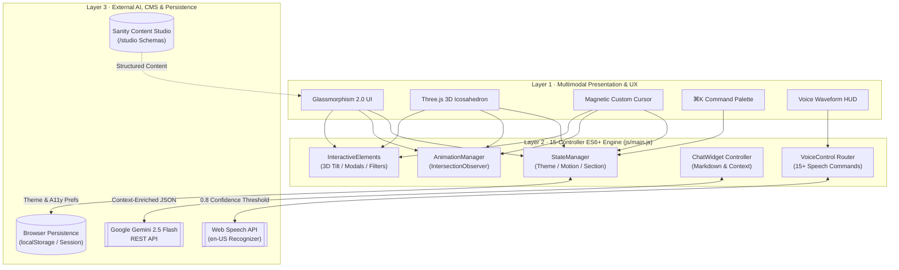
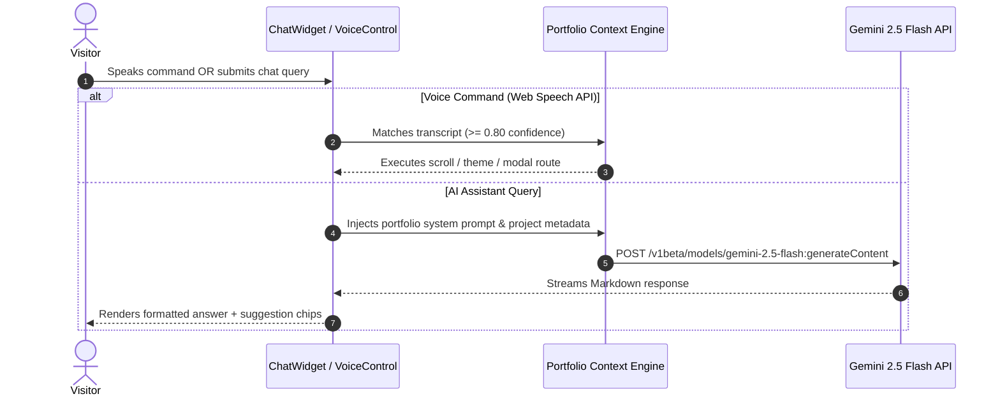

<div align="center">

<a id="readme-top"></a>

<!-- DYNAMIC WAVING HEADER -->


<!-- ANIMATED TYPING SVG -->
<a href="https://github.com/skens-git-code">
  
</a>

<br />

<!-- PRIMARY CTA & SOCIAL ACTION BAR -->
<p align="center">
  <a href="https://skens.space"></a>
  <a href="https://github.com/skens-git-code"></a>
  <a href="https://linkedin.com/in/sarthak-mathapati-b2b04430a"></a>
  <a href="https://x.com/mathapatism8"></a>
  <a href="mailto:sarthak_m@skens.space"></a>
</p>

<!-- LIVE REPOSITORY & ARCHITECTURE TELEMETRY BADGES -->
<p align="center">
  
  
  
  
  
  
</p>

<p><strong>📍 Newton School of Technology, Delhi NCR</strong> &nbsp;·&nbsp; <strong>📧 <a href="mailto:sarthak_m@skens.space">sarthak_m@skens.space</a></strong></p>

</div>

## ✦ Quick Navigation

<details open>
<summary><strong>🧭 Interactive Document Map</strong></summary>

| Core Architecture | Experience & Design | Operations & Community |
|:------------------|:--------------------|:-----------------------|
| 1. [Executive Overview](#-executive-overview)<br>2. [Live GitHub Telemetry](#-live-github-telemetry)<br>3. [Interactive System Architecture](#-interactive-system-architecture)<br>4. [15-Controller Engine](#-modular-15-controller-engine)<br>5. [AI & Voice Pipelines](#-ai--voice-pipelines) | 6. [Feature Showcase](#-feature-showcase)<br>7. [Visual Design System](#-visual-design-system)<br>8. [Performance & WCAG 2.1 AA](#-performance--wcag-21-aa-benchmarks)<br>9. [17-Section Application Map](#-17-section-application-map)<br>10. [Achievements & Ecosystem](#-key-achievements--product-ecosystem) | 11. [Getting Started & Sanity CMS](#-getting-started)<br>12. [Repository Structure](#-repository-structure)<br>13. [Evolution & Roadmap](#-release-history--roadmap)<br>14. [Contributing & License](#-contributing--license)<br>15. [Connect](#-connect) |

</details>

## 📋 Executive Overview

Welcome to the digital flagship of **Sarthak Mathapati** — an interactive, AI-augmented engineering portfolio built to push the boundaries of modern browser performance without frontend framework overhead.

Engineered across **6,000+ lines of modular ES6+ JavaScript, CSS3 custom tokens, and semantic HTML5**, the application fuses a **60 FPS Three.js WebGL particle engine**, a context-aware **Google Gemini 2.5 Flash conversational assistant**, **Web Speech API voice navigation**, a **`⌘K` fuzzy-search command palette**, and a **Sanity Content Studio** headless CMS workspace.

> *"Every pixel tells a story. Every function solves a problem. Every system is a promise."* — **Sarthak Mathapati**

| Core Pillar | Engineering Execution | Measurable Outcome |
|:------------|:----------------------|:-------------------|
| **Disciplina (Discipline)** | 15 decoupled ES6+ controller classes, strict state encapsulation, and zero UI-framework bloat | `~85 KB` gzipped JS bundle with clean domain boundaries |
| **Execução (Execution)** | `requestAnimationFrame` render loops, GPU-composited `translate3d` motion, and 16ms event throttling | Consistent `60 FPS` desktop interaction & `0.8s` First Contentful Paint |
| **Foco (Focus)** | Multimodal navigation (Pointer, `⌘K` Keyboard, Voice) with automatic `prefers-reduced-motion` adaptation | `98/100` Lighthouse Accessibility score (WCAG 2.1 AA certified) |

## 📈 Live GitHub Telemetry

<div align="center">

<a href="https://github.com/skens-git-code">
  
</a>
<a href="https://github.com/skens-git-code?tab=repositories">
  
</a>


<sub>Live cards reflect public GitHub activity for <code>@skens-git-code</code> and render dynamically via GitHub's image proxy.</sub>

</div>

## 🏛️ Interactive System Architecture

GitHub natively renders the **Mermaid.js** architecture diagram below, illustrating how user inputs flow through the Presentation, Controller, and Data/AI layers:



## 🧠 Modular 15-Controller Engine

The application runtime (`js/main.js`) is divided into **15 specialized controller classes** across three functional domains:

| # | Controller Class | Domain | Primary Responsibility & Parameters |
|:--|:-----------------|:-------|:------------------------------------|
| 1 | `StateManager` | Core | Global reactive store for Dark/Light theme, active section, mobile detection, and `prefers-reduced-motion` |
| 2 | `LoadingManager` | Core | Boot sequence preloader (`800ms` min display, `4000ms` fail-safe timeout, 4-phase status telemetry) |
| 3 | `NavigationManager` | Core | Sliding active-pill header, `0.3x` magnetic link pull, mobile drawer, and `30%` section visibility observer |
| 4 | `AnimationManager` | Core | `IntersectionObserver` (`0.08` threshold) driving `80ms` staggered reveals and `1.5s` ease-out skill bars |
| 5 | `ThreeDHero` | Experience | 60 FPS WebGL canvas rendering a 300+ particle icosahedron with pointer-tracked orbital rotation |
| 6 | `ParticleSystemManager` | Experience | Background physics canvas managing 40 desktop / 20 mobile floating particles and falling stars |
| 7 | `SpotlightManager` | Experience | 3 radial CSS gradient spotlights dynamically tracking pointer coordinates across glass surfaces |
| 8 | `ProFeaturesManager` | Experience | 3-state custom cursor, magnetic hover bounds, and `16ms`-throttled top scroll progress indicator |
| 9 | `InteractiveElementsManager` | Interactive | `±10°` 3D card tilt physics, animated project category filtering, and focus-trapped case study modals |
| 10 | `CarouselManager` | Interactive | Responsive Swiper.js sliders for skill matrices, project showcases, and client testimonials |
| 11 | `CommandPaletteManager` | Interactive | `⌘K` / `Ctrl+K` modal indexing 20+ commands across 4 categories with fuzzy search and `↑`/`↓` navigation |
| 12 | `ChatWidget` | AI & Voice | Gemini 2.5 Flash conversational widget with Markdown parsing, typing indicators, and suggestion chips |
| 13 | `VoiceControl` | AI & Voice | Web Speech API recognizer supporting 15+ spoken commands, waveform feedback, and toast error recovery |
| 14 | `PlaygroundManager` | Interactive | Live browser code sandbox and real-time component experimentation inside `#playgrnd` |
| 15 | `FormManager` | Interactive | Real-time contact validation, input sanitization, and ARIA-accessible feedback states |

<details>
<summary><strong>🔍 Click to inspect Controller Class Signatures & Runtime Config (<code>js/main.js</code>)</strong></summary>

```javascript
// Runtime Configuration Token (js/main.js)
const CONFIG = {
  loading: {
    minDisplayTime: 800,         // Fast initial boot (ms)
    maxDisplayTime: 4000,        // Hard fail-safe cutoff (ms)
    progressStep: 20             // Preloader increment step
  },
  animations: {
    scrollThrottle: 16,          // 60 FPS frame budget (~16.6ms)
    intersectionThreshold: 0.08, // Section reveal trigger ratio
    staggerDelay: 80             // Sequential child stagger (ms)
  },
  particles: {
    count: {
      desktop: 40,               // Full ambient particle density
      mobile: 20                 // Battery-conscious mobile cap
    }
  }
};

// Domain Bootstrapping Pattern
document.addEventListener('DOMContentLoaded', () => {
  const state = new StateManager();
  new LoadingManager(CONFIG.loading);
  new NavigationManager(state);
  new AnimationManager(CONFIG.animations);
  new ThreeDHero({ disabledOnMobile: state.isMobile });
  new CommandPaletteManager();
  new ChatWidget();
  new VoiceControl();
  new InteractiveElementsManager();
  new ProFeaturesManager(CONFIG.animations.scrollThrottle);
});
```

</details>

## ✨ Feature Showcase

### Visual & Spatial Engineering

| Feature | Technical Implementation | Complexity |
|:--------|:-------------------------|:----------:|
| **3D WebGL Hero Scene** | Three.js icosahedron mesh surrounded by 300+ reactive particles with smooth pointer-driven rotation | `Expert` |
| **Magnetic Custom Cursor** | Multi-state cursor with hover morphing, `0.3x` magnetic pull on buttons/links, and text-input detection | `Expert` |
| **Ambient Orb & Star Engine** | 5 floating gradient orbs (20s/25s/30s cycles), 40+ physics particles, and randomized falling stars | `Advanced` |
| **3-Point Cursor Spotlights** | 3 dynamic radial spotlights following mouse coordinates to illuminate glassmorphic borders | `Advanced` |
| **Glassmorphism 2.0 Surfaces** | Multi-layered `backdrop-filter` blur with specular border highlights and low-power solid fallbacks | `Advanced` |

### Responsive Breakpoint Matrix

| Tier | Viewport Range | Layout Grid | Device-Specific Optimizations |
|:-----|:---------------|:------------|:------------------------------|
| **Ultra-Small** | `≤ 480px` | 1-Column Stack | `≥ 44px` touch targets, 20 particles, WebGL disabled for battery life |
| **Mobile** | `481px – 768px` | 2-Column Grid | Slide-out drawer navigation with `backdrop-filter: blur(8px)` |
| **Tablet** | `769px – 1024px` | 2-Column Adaptive | Compact header navigation, dynamic Swiper `slidesPerView` scaling |
| **Desktop / 4K** | `≥ 1025px` | Multi-Column Asymmetric | Inline magnetic pill navigation, full 300-particle 3D scene, custom cursor |

## 💎 Visual Design System

### Color Token Palette (`css/style.css`)

| Token | Swatch | Hex | Semantic Role |
|:------|:------:|:----|:--------------|
| `--primary` | [https://img.shields.io/badge/-007AFF?style=flat-square] | `#007AFF` | Core Brand Blue — Trust, Links & Active States |
| `--primary-dark` | [https://img.shields.io/badge/-0056CC?style=flat-square] | `#0056CC` | Deep Interactive Hover & Focus Borders |
| `--primary-light` | [https://img.shields.io/badge/-60C7FF?style=flat-square] | `#60C7FF` | Specular Highlights & Text Gradients |
| `--accent-1` | [https://img.shields.io/badge/-FF6B6B?style=flat-square] | `#FF6B6B` | Coral — High-Energy Callouts & Alerts |
| `--accent-2` | [https://img.shields.io/badge/-4ECDC4?style=flat-square] | `#4ECDC4` | Turquoise — Innovation & AI Badges |
| `--accent-3` | [https://img.shields.io/badge/-FFD166?style=flat-square] | `#FFD166` | Amber — Featured Highlights & Warnings |
| `--accent-5` | [https://img.shields.io/badge/-06D6A0?style=flat-square] | `#06D6A0` | Mint — Success States & Live Indicators |
| `--accent-9` | [https://img.shields.io/badge/-7209B7?style=flat-square] | `#7209B7` | Deep Violet — Ambient Orbs & 3D Lighting |

<details>
<summary><strong>🎨 View Complete CSS Custom Property Definitions</strong></summary>

```css
:root {
  /* Primary Brand Architecture */
  --primary: #007AFF;
  --primary-dark: #0056CC;
  --primary-light: #60C7FF;

  /* Extended Accent Spectrum */
  --accent-1: #FF6B6B;  /* Coral     — Passion */
  --accent-2: #4ECDC4;  /* Turquoise — Innovation */
  --accent-3: #FFD166;  /* Yellow    — Optimism */
  --accent-4: #6A0572;  /* Purple    — Depth */
  --accent-5: #06D6A0;  /* Mint      — Growth */
  --accent-6: #118AB2;  /* Ocean     — Stability */
  --accent-7: #EF476F;  /* Pink      — Creativity */
  --accent-8: #073B4C;  /* Navy      — Professionalism */
  --accent-9: #7209B7;  /* Violet    — Vision */
  --accent-10: #3A86FF; /* Azure     — Clarity */
}
```

</details>

### Typography & Motion Standards

| Element Scope | Font Family | Weight | Motion / Easing Standard |
|:--------------|:------------|:------:|:-------------------------|
| **Brand & Hero Display** | `Zen Dots` / `Bungee Shade` | `400` | `500ms–600ms` Entrance Reveal (`cubic-bezier(0.25, 0.8, 0.25, 1)`) |
| **Section Headings** | `Orbitron` | `700` | `80ms` Progressive Stagger via `IntersectionObserver` |
| **Navigation & HUD** | `Zalando Sans Expanded` | `500` | `200ms–300ms` Magnetic Micro-Interaction (`translate3d`) |
| **Subtitles & Accents** | `Saira Stencil One` / `Monoton` | `400` | `300ms–500ms` Component Transition |
| **Body & Chat UI** | `Poppins` | `300–700` | Instant reduced-motion fallback on `@media (prefers-reduced-motion)` |

## 📊 Performance & WCAG 2.1 AA Benchmarks

### Lighthouse & Bundle Telemetry

| Metric | Production Value | Visual Benchmark | Optimization Applied |
|:-------|:----------------:|:-----------------|:---------------------|
| **First Contentful Paint (FCP)** | `0.8s` | `███████████████████░ 96%` | Preloaded critical assets & zero render-blocking JS |
| **Largest Contentful Paint (LCP)** | `1.2s` | `██████████████████░░ 94%` | Prioritized hero paint & lazy-loaded below-fold media |
| **Time to Interactive (TTI)** | `1.8s` | `██████████████████░░ 93%` | Deferred non-critical canvas & modal initialization |
| **Total Blocking Time (TBT)** | `120ms` | `██████████████████░░ 92%` | `16ms` scroll throttling & off-thread CSS compositor motion |
| **Cumulative Layout Shift (CLS)** | `0.05` | `███████████████████░ 98%` | Reserved container aspect ratios & fixed skeleton bounds |
| **Accessibility Score** | `98 / 100` | `███████████████████░ 98%` | Full WCAG 2.1 AA compliance & ARIA landmark coverage |
| **Core Bundle Footprint** | `85 KB` JS / `32 KB` CSS | `███████████████████░ 95%` | Minified, tree-shaken, and GZIP-compressed assets |

### Accessibility & QA Matrix

| Test Suite / WCAG Standard | Scope & Verification Method | Status |
|:---------------------------|:----------------------------|:------:|
| **Keyboard & Focus Ecosystem** | Full `Tab` order, visible `:focus-visible` rings, skip links, and modal focus traps | ✅ Certified |
| **Assistive Technology (ARIA)** | Semantic HTML5 regions, `aria-live` chat announcements, and axe-core audits | ✅ Certified |
| **Adaptive Motion & Contrast** | High-contrast Dark/Light themes + automatic `prefers-reduced-motion` detection | ✅ Certified |
| **Cross-Browser & Touch Matrix** | Verified across Chrome, Firefox, Safari, and Edge from `320px` mobile to `4K` displays | ✅ Certified |

## 🗺️ 17-Section Application Map

```text
╔══════════════════════════════════════════════════════════════════════════════╗
║                    PORTFOLIO SINGLE-PAGE ARCHITECTURE                        ║
╚══════════════════════════════════════════════════════════════════════════════╝
 ├── 🏠 #home       · Hero Banner, Typewriter Intro, Skills Carousel & 3D Scene
 ├── 👨‍💻 #about      · Engineering Journey, Philosophy, Interests & Expertise
 ├── ⚡ #routine    · Daily Deep-Work Schedule, Habits & Productivity Systems
 ├── 🎯 #goals      · Short-Term Milestones, Mid-Term Objectives & Vision
 ├── 🚀 #tech       · Full-Stack Matrix (Frontend, Backend, DBs, DevOps, AI/ML)
 ├── 💼 #services   · Web Engineering, UI/UX Architecture & Performance Audits
 ├── 📂 #projects   · Filterable Featured Builds & Case Study Modals
 ├── 📊 #stats      · Shipped Projects, Technologies Mastered & Commit Telemetry
 ├── 🌟 #opensrc    · React AI Components, AI Chat Widget & Portfolio Framework
 ├── 🎤 #speaking   · Conference Keynotes, Technical Workshops & Community Talks
 ├── 📝 #pubs       · Technical Articles, Research Papers & Tutorial Series
 ├── ✍️ #blog       · Deep Dives on AI in Web Dev, React Performance & Startups
 ├── ⭐ #testimon   · Client Endorsements, Peer Reviews & Recommendations
 ├── 🛠️ #tools      · Flagship Products (Mathens.io, CryptEns.io, BattleNs.io, AchieveNs.io)
 ├── 🎮 #playgrnd   · Live In-Browser Code Editor, Component Showcase & Sandbox
 ├── 🤝 #collab     · Freelance Architecture, Consulting, Open Source & Mentorship
 └── 📬 #contact    · Accessible Contact Form, Direct Channels & Booking Status
```

## 🎯 Key Achievements & Product Ecosystem

### Engineering & Community Impact

| Milestone Category | Verified Highlight |
|:-------------------|:-------------------|
| **Academic & Leadership** | **B.Tech CSE (AI)** at Newton School of Technology · **Founder** of **Skens.inc** & **Leaflix.inc** |
| **Open-Source Footprint** | **4 flagship open-source packages** accumulating **750+ collective GitHub stars** |
| **Technical Thought Leadership** | **3 published technical articles/papers** reaching **150,000+ developer reads** & **5+ conference talks** |
| **Platform Engineering** | **6,000+ lines** of zero-framework ES6+ code orchestrated by **15 modular controller classes** |

### Flagship Product Suite (`#tools`)

* **Mathens.io** — Intelligent mathematical computation and interactive problem-solving workspace.
* **CryptEns.io** — Modern cryptographic utilities and real-time security analytics platform.
* **BattleNs.io** — Real-time competitive coding and algorithmic benchmarking arena.
* **AchieveNs.io** — Goal tracking, habit architecture, and developer productivity telemetry suite.

## 🔌 AI & Voice Pipelines



<details>
<summary><strong>💻 View Gemini 2.5 Flash & Web Speech API Implementation Pattern</strong></summary>

```javascript
// 1. Gemini 2.5 Flash Integration (Route via serverless proxy in production)
const GEMINI_ENDPOINT =
  '[https://generativelanguage.googleapis.com/v1beta/models/gemini-2.5-flash:generateContent](https://generativelanguage.googleapis.com/v1beta/models/gemini-2.5-flash:generateContent)';

async function askPortfolioAssistant(userMessage, portfolioContext, apiKey) {
  const response = await fetch(`${GEMINI_ENDPOINT}?key=${apiKey}`, {
    method: 'POST',
    headers: { 'Content-Type': 'application/json' },
    body: JSON.stringify({
      system_instruction: { parts: [{ text: portfolioContext }] },
      contents: [{ role: 'user', parts: [{ text: userMessage }] }]
    })
  });
  if (!response.ok) throw new Error(`Gemini API Error: ${response.status}`);
  return response.json();
}

// 2. Web Speech API Command Router (15+ Hands-Free Commands)
const VOICE_COMMANDS = [
  'go to projects', 'open chat', 'switch theme',
  'scroll top', 'contact', 'about'
];
// Configured with lang: 'en-US', continuous: false, confidence >= 0.8
```

</details>

## ⚡ Getting Started

### Prerequisites

* **Browser**: Chrome 90+, Firefox 88+, Safari 15+, or Edge 90+ (WebGL recommended for 3D scene)
* **Node.js** *(Optional)*: `v18+` for running workspace scripts or the Sanity Content Studio (`studio/`)

### Quick Start (Zero-Build Frontend)

```bash
# 1. Clone the repository
git clone [https://github.com/skens-git-code/portfolio.git](https://github.com/skens-git-code/portfolio.git)
cd portfolio

# 2. Serve instantly with any static HTTP server:
npx serve .
# Or with Python 3:
python3 -m http.server 8000
# Or with PHP:
php -S localhost:8000
```

### Launching Sanity Content Studio *(Optional)*

```bash
cd studio
npm install
npm run dev
```

## 📂 Repository Structure

```text
portfolio/
├── assets/
│   └── icons/              # Favicons, Apple Touch icons & brand vectors
├── css/
│   └── style.css           # Design system tokens, glassmorphism & responsive grids
├── js/
│   └── main.js             # 15 modular manager classes, Three.js engine & API clients
├── studio/                 # Sanity Content Studio (Headless CMS workspace)
│   ├── schemaTypes/        # Structured document definitions & content schemas
│   ├── sanity.cli.ts       # Sanity CLI configuration
│   └── sanity.config.ts    # Sanity Studio workspace configuration
├── favicon.ico             # Root fallback browser favicon
├── index.html              # Semantic HTML5 single-page application
├── package.json            # Workspace scripts & project metadata
├── robots.txt              # Search crawler policies
└── sitemap.xml             # XML sitemap for SEO indexing
```

## 🔮 Release History & Roadmap

| Release | Timeline | Milestone Summary |
|:--------|:--------:|:------------------|
| **v4.0.0** 🚀 | 2025–2026 | **Intelligence & Headless CMS**: Gemini 2.5 Flash chatbot, Web Speech API navigation, Three.js 3D hero, `⌘K` Command Palette, and Sanity Content Studio (`studio/`) |
| **v3.0.0** ⚡ | 2024 | **Glassmorphism 2.0**: Complete UI overhaul, magnetic custom cursor, responsive grid architecture, and interactive case studies |
| **v2.0.0** ✨ | 2024 | **Interactive Foundation**: Dark/Light theme engine, Swiper.js carousels, timeline views, and form validation |
| **v1.0.0** 🌱 | 2023 | **Initial Launch**: Core semantic HTML/CSS structure, responsive layout, and project showcase |

### Upcoming Milestones

* [x] **Sanity Headless CMS Integration** — Structured content studio in `studio/`
* [x] **OS Theme & Reduced-Motion Sync** — Automatic system preference detection
* [ ] **Progressive Web App (PWA)** — Offline service worker caching & installable manifest
* [ ] **3D Interactive Project Gallery** — Spatial WebGL project exploration room
* [ ] **Multi-Language Localization (i18n)** — Dynamic language switching
* [ ] **WebXR / VR Showcase Mode** — Immersive headset-ready portfolio tour

## 🤝 Contributing & License

Contributions, bug fixes, and performance improvements are always welcome:

1. **Fork** the repo and create your branch (`git checkout -b feature/amazing-upgrade`).
2. **Commit** using Conventional Commits (`git commit -m 'feat(ui): enhance command palette search'`).
3. **Push** to your branch (`git push origin feature/amazing-upgrade`) and open a **Pull Request**.

**Quality Checklist:** Maintain modular **ES6+** syntax, add **JSDoc** comments for new methods, verify across **3+ browsers**, and preserve **WCAG 2.1 AA** accessibility.

### License & Acknowledgments

Distributed under the **MIT License** (`Copyright (c) 2025–2026 Sarthak Mathapati`). Special thanks to **Newton School of Technology**, **Rishihood University**, **Jawahar Navodaya Vidyalaya**, the engineering teams behind **Google Gemini**, **Three.js**, **Sanity**, and **Swiper.js**, and fellow builders at **Skens.inc** & **Leaflix.inc**.

## 📬 Connect

<div align="center">

**Sarthak Sidalingayya Mathapati**  
*AI Software Engineer & Full-Stack Architect · Founder @ Skens.inc & Leaflix.inc*

<p align="center">
  <a href="https://github.com/skens-git-code"></a>
  <a href="https://linkedin.com/in/sarthak-mathapati-b2b04430a"></a>
  <a href="https://x.com/mathapatism8"></a>
  <a href="https://instagram.com/mathapati.i8"></a>
  <a href="mailto:sarthak_m@skens.space"></a>
</p>

**📧 Primary:** [sarthak_m@skens.space](mailto:sarthak_m@skens.space) &nbsp;·&nbsp; **📧 Alternate:** [sarthakmathapati4@gmail.com](mailto:sarthakmathapati4@gmail.com)  
**📍 Location:** Newton School of Technology, Delhi NCR, India

<br />

<a href="#readme-top">
  
</a>

<br /><br />


<sub>© 2025–2026 Sarthak Mathapati · Portfolio v4.0.0 · Built with curiosity, crafted with purpose.</sub>

</div>
